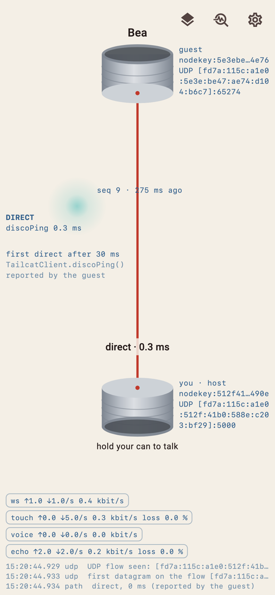

# Tin Can

A private line between two devices, and an example for
[libtailcat](https://pub.dev/packages/libtailcat).

You pair once with a QR code. After that, whenever both of you have the app
open, you see each other's fingertip as a glow on your screen, feel the other
phone thud when your fingertips meet, pluck the string between the cans, and
talk while holding your can. There is no account and no server of ours. The
string shows whether the packets go through a relay or straight from one
device to the other: it bends over a peg labelled with the relay's city, and
snaps straight with a twang when NAT traversal succeeds.



*A real session, with both cans on one Mac: the path is direct, at 0.3 ms.
The glow is the partner's fingertip.*

Tin Can is an example, not a product: it is not in any app store, and you
build it from source. Everything the library reports, and everything the app
measures, is on screen, so the app doubles as a tour of libtailcat. One tap
hides the X-ray notes.

## Run it

You need Flutter 3.47 or later and two devices: Android 7.0+, iOS 15+ or
macOS 13+, in any combination. A Mac and a simulator or emulator on it make a
good pair while developing.

```sh
cd example/tin_can
flutter pub get
flutter run            # on each device
```

On one device, tap *Tie a string*. On the other, tap *Catch the other end* and
scan the QR code, or paste the invite you were sent. Both screens then show
the same six symbols; when they match, the first person taps *They match*,
and the string is tied.

**Where the native library comes from.** libtailcat's build hook supplies it.
By default it downloads a prebuilt, checksummed library. Inside this
repository, before the first native release exists, build it from source
instead: put `{"native": "source"}` in `hook/local_config.json` at the
repository root (that needs Go, and Xcode or the Android NDK for the mobile
targets). `pubspec.yaml` shows where the hook's settings go.

**Hot reload, not hot restart.** The native library cannot be unloaded, so a
hot restart leaves the old server running with the same key next to the new
one, and the two fight over the relay. Stop the app and run it again instead.

**Release builds for Android**: `flutter build apk --split-per-abi`, so that
each APK carries one copy of the library.

## What it shows of libtailcat

| libtailcat | Where Tin Can uses it |
|------------|-----------------------|
| `TailcatServer.start` with saved `TailcatKeys` and a pinned `region` | The host's address stays the same for the life of the string |
| `TailcatClient` with a saved `privateKey` | The guest's identity on the host's allowlist |
| `allowedClients` | Tying the string locks everyone else out |
| `TailcatAddress.parse` | Checking an invite, computing the safety symbols, and showing what an address contains |
| `HttpServer.listenOn`, `connectionFactory`, `WebSocket` | The control channel: ordinary `dart:io` WebSockets with no cloud behind them |
| `listenUdp`, `connectUdp` | Touch, voice and echoes |
| `discoPing`, `TailcatPath` and `ping` | The string, and the path and relay latencies in the Inspector |
| The sealed `TailcatException` | What the status line says: timeouts mean "waiting", failures "network trouble" |
| `TailcatSecret` redaction | Secrets cannot end up in logs by accident |
| `close` and `drain` | Hanging up cleanly when the app goes to the background |
| `Tailcat.abiVersion`, `Tailcat.buildInfo` | The Inspector's Library section |
| `localAddress`; `address`, `port`, `remoteAddress`, `remotePort` of listeners, sockets and flows | Tunnel addresses in the X-ray and the Inspector |
| `TailcatDatagramSocket.maxPayloadSize` | Datagram sizes, shown against the limit |

[`lib/src/line/`](lib/src/line/) is the networking: pairing, the host, the
guest and the wire protocol. It has no Flutter imports, so it can be read on
its own, and unit tests run it over an in-memory network.

## How it works

### Two roles

Whoever ties the string is the **host** and runs a `TailcatServer` for as
long as the string exists. The other side is the **guest** and only ever
runs a `TailcatClient`. The guest opens every connection; either side may
open the app first, and the guest keeps dialing (1, 2 and 4 seconds apart,
then every 10) until the host is there.

The host's server listens on two ports inside the tunnel:

| Port | Kind | Carries |
|------|------|---------|
| 80 | TCP | HTTP, for WebSocket upgrades only: `/v1/pair` while pairing, `/v1/line` for a session |
| 5000 | UDP | Touch positions, voice, and echoes that keep the flow alive and measure the round trip and loss |

### Tying a string

1. The host generates keys and starts a server with an open allowlist. Its
   address is the QR code. Nothing is saved yet.
2. The guest checks the invite with `TailcatAddress.parse()`, generates a
   client key, connects to `/v1/pair` and sends its name and public key.
3. Both screens show six symbols: the first 36 bits of SHA-256(host public
   key ‖ guest public key), six bits per symbol. If someone used the invite
   first, the screens disagree.
4. When the host confirms, it saves the string, tells the guest, and closes
   the server. The line then starts a new server with the guest's key as the
   only entry on its allowlist. The restart matters: a client that connected
   while the allowlist was open would otherwise stay connected, and libtailcat
   can neither disconnect a client nor take a key off the allowlist.

The host saves the relay region its first server picked, as the address
embeds it, and pins it on every later start. The same keys and the same
region give the same address text, so the address the guest saved keeps
working.

### A session

The guest connects to `/v1/line` and says `hello`; the host answers
`welcome`. The guest then opens the UDP flow and sends an echo at once,
because a server sees a UDP flow only when its first datagram arrives. The
guest probes the path with `discoPing` every second until it is direct and
every five seconds after that, and tells the host each result: only a client
can probe the path. When the app goes to the background, it says `bye` and
closes, with drain; when it comes back, it starts again.

### Wire protocol

Control messages are JSON objects over the WebSocket, at most 64 KB each.
The version is in the path; unknown types and fields are ignored.

| type | From | Fields | Meaning |
|------|------|--------|---------|
| `pair` | guest | `name`, `key` | Start pairing (`/v1/pair`) |
| `paired` | host | `name` | Pairing confirmed |
| `hello` | guest | `name` | Start a session (`/v1/line`) |
| `welcome` | host | `name` | Session accepted |
| `path` | guest | `direct`, `ms`, `relay`, `relayMs` | The latest `discoPing` result, and the latest `ping` |
| `pluck` | either | | The string was plucked |
| `meet` | host | | The fingertips met; the host decides, so both feel it once |
| `talk` | either | `on` | Push-to-talk started or stopped |
| `cut` | either | | Unpair; the receiver deletes the string too |
| `bye` | either | | Hanging up |
| `ping`, `pong` | either | `t` | Round-trip probe over the WebSocket, every 2 s |

Realtime datagrams are binary and big-endian, with the kind first:

| Kind | Layout | Bytes |
|------|--------|-------|
| 1 touch | seq u16, x u16, y u16, flags u8 | 8 |
| 2 voice | seq u16, sample time u32, 320 μ-law samples | 327 |
| 3 echo | seq u16, sender time u32 (ms) | 7 |
| 4 echo reply | the echo's seq and time | 7 |

### Voice

Holding your can records 16 kHz mono audio (with the `record` plugin), cuts
it into 20 ms frames and sends each as 8-bit μ-law: 50 datagrams and about
130 kbit/s while you talk, nothing otherwise. The other side plays it through
a 60 ms jitter buffer and a 300–3400 Hz band-pass filter that makes it sound
like a tin can (with `flutter_pcm_sound`). The twang of a pluck is
synthesized with the Karplus–Strong algorithm and played through the same
path. The Inspector shows the jitter (RFC 3550), the buffer, and an estimate
of the mouth-to-ear delay, part by part.

## Privacy and security

- Addresses, private keys and real IP addresses are masked on screen until
  you tap them, and a copied log keeps them masked unless you revealed them.
  They never go to the platform log. The app has no analytics and no crash
  reporting.
- Your name goes only to your partner, through the tunnel.
- **The keys are kept in `shared_preferences`.** That is fine for an example,
  but plain preferences are not encrypted and end up in backups. A real app
  keeps private keys in the platform keychain or keystore, as libtailcat's
  README advises.

## What it cannot do

- **Ring the other phone.** Without a server there are no push
  notifications, so the line is live only while both apps are open. The
  waiting screen says so.
- **Run in the background.** iOS suspends background apps and their tunnels.
- **Do without the relays.** Tin Can uses Tailcat's public relays, which are
  free and rate limited. Traffic is small by design: touch is a few KB/s and
  voice flows only while a can is held. If you build on Tin Can, bring your
  own [DERP relay](https://github.com/tailscale/tailscale/tree/main/cmd/derper#derp)
  (see "Relays" in libtailcat's README).

## Tests

```sh
flutter test test/unit          # everything, over an in-memory network
flutter test test/native        # real tunnels on a local relay; needs Go and
                                # {"native": "source"} in hook/local_config.json
flutter test integration_test -d macos   # the app itself, two cans in one
                                         # process, over the public relays
```

## Layout

| Path | Contents |
|------|----------|
| `lib/src/line/` | Pairing, `Host`, `Guest`, `Session`, the message and datagram codecs, the safety code, the path monitor; `tailcat_network.dart` is the only file that talks to libtailcat |
| `lib/src/audio/` | μ-law, the jitter buffer, the filters, the pluck and the mixer (pure Dart), and `devices.dart` over the two audio plugins |
| `lib/src/telemetry/` | Rate meters, loss and jitter, latency history, the event log, the wire tap, masking |
| `lib/src/store/` | The stored string |
| `lib/src/ui/` | The screens and the painters: everything is drawn with `CustomPainter` |
